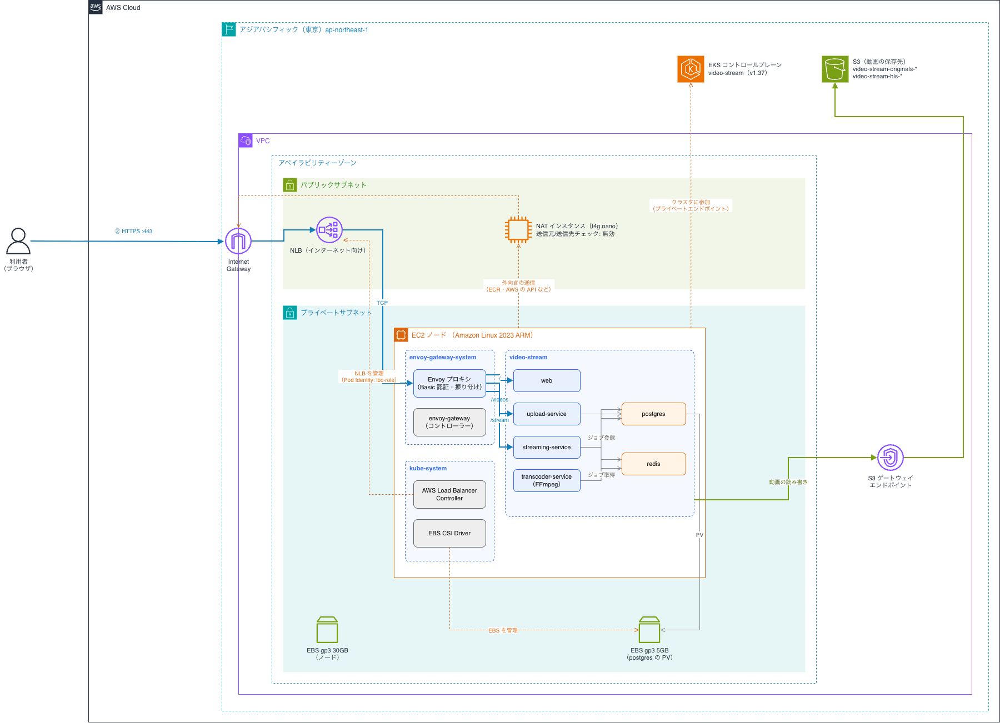

# video-stream

Go + Kubernetes + HLS による動画配信プロジェクトです。  
ユーザーが動画をアップロードすると、バックグラウンドで FFmpeg により HLS 形式に変換され、ストリーミング配信できます。  
本番のアクセスには、Basic認証が設定されています。
## AWS構成図


## アーキテクチャ

```
[Client (Browser)]
    │
    ▼
[Gateway API (Envoy Gateway)]
    │
    ├─ GET  / ───────► [Web (React SPA / nginx) :8080]
    │
    ├─ POST /videos ──► [Upload Service :8080]
    │                        │
    │                   MinIO (originals bucket) に保存
    │                   PostgreSQL にメタデータ保存 (status: pending)
    │                   Redis キューにジョブ投入
    │
    │                   [Transcoder Service]
    │                        │
    │                   FFmpeg で HLS 変換
    │                   MinIO (hls bucket) にアップロード
    │                   PostgreSQL にステータス更新 (status: ready)
    │
    └─ GET /stream ──► [Streaming Service :8082]
                             │
                        MinIO から .m3u8 / .ts を取得して配信
```

### 使用技術

| 役割 | 技術 |
|---|---|
| 言語 | Go 1.23 |
| HTTP ルーター | go-chi/chi v5 |
| データベース | PostgreSQL 16 (pgx/v5) |
| キュー | Redis 7 (go-redis/v9) |
| オブジェクトストレージ | MinIO 互換 ([Silo](https://silo.pgsty.com/)）|
| 動画変換 | FFmpeg |
| フロントエンド | React 19 + TypeScript / Vite |
| HLS 再生 | hls.js (Safari はネイティブ再生) |
| コンテナオーケストレーション | Kubernetes (Docker Desktop / Amazon EKS) |
| 外部公開 (L7 ルーティング) | Gateway API (Envoy Gateway) |
| マニフェスト管理 | Kustomize |
| クラウド | AWS (EKS / ECR / NLB / ACM / Route 53 / Parameter Store) |
| CI/CD | GitHub Actions |

---

## ディレクトリ構成

```
video_stream/
├── services/
│   ├── upload/          # Upload Service (POST /videos, GET /videos)
│   ├── transcoder/      # Transcoder Worker (Redis → FFmpeg → MinIO)
│   └── streaming/       # Streaming Service (GET /stream/{id}/...)
├── pkg/
│   ├── models/          # 共通データモデル
│   ├── db/              # PostgreSQL (pgxpool, VideoRepository)
│   ├── queue/           # Redis キュークライアント
│   └── storage/         # MinIO クライアント
├── web/                 # Web フロントエンド (React + Vite)
│   ├── src/
│   └── nginx/           # 本番配信用 nginx 設定 (静的配信 + API プロキシ)
├── k8s/
│   ├── base/            # Kustomize ベースマニフェスト（ローカル用）
│   └── overlays/
│       └── eks/         # EKS 用の差分（ECR イメージ・NLB・Basic 認証）
├── deploy/
│   ├── build-images.sh  # ローカルイメージビルドスクリプト
│   └── eks/             # EKS へのデプロイスクリプト・GitHub Actions 用の AWS 準備スクリプト
├── .github/workflows/   # リリース PR の作成・EKS へのデプロイ (GitHub Actions)
└── docker-compose.yml   # ローカル開発用
```

---

## ローカル開発 (Docker Compose)

### 前提条件

- Docker Desktop

### 起動

```bash
# 全サービスをビルド・起動
docker compose up --build
```

### エンドポイント

| サービス | URL |
|---|---|
| Web UI | http://localhost:3000 |
| Upload API | http://localhost:8080 |
| Streaming API | http://localhost:8082 |
| MinIO Console | http://localhost:9001 (minioadmin / minioadmin) |

### 動作確認

ブラウザで http://localhost:3000 を開き、動画をアップロードすると、変換完了後にそのまま再生できます。

API を直接叩く場合:

```bash
# 1. 動画をアップロード
curl -X POST http://localhost:8080/videos \
  -F "title=My Video" \
  -F "file=@/path/to/video.mp4"
# → {"id":"<VIDEO_ID>", "status":"pending", ...}

# 2. 変換ステータスを確認（ready になるまで待つ）
curl http://localhost:8080/videos/<VIDEO_ID>
# → {"id":"...", "status":"ready", "hls_key":"<VIDEO_ID>/hls/index.m3u8", ...}

# 3. HLS プレイリストを取得
curl http://localhost:8082/stream/<VIDEO_ID>/index.m3u8

# 4. VLC や hls.js でストリーミング再生
# URL: http://localhost:8082/stream/<VIDEO_ID>/index.m3u8
```

### フロントエンド開発 (Vite)

Docker Compose の `web` サービスは Vite の開発サーバー（`web/Dockerfile` の `dev` ステージ）で動いており、`web/` をバインドマウントしています。`web/src` などを編集すると http://localhost:3000 にホットリロードで即時反映されるため、ビルドし直す必要はありません。

`package.json` の依存関係を変更したときだけ、イメージを作り直し、node_modules のボリュームも新しくします。

```bash
docker compose up -d --build -V web
```

Docker を使わずにホスト上で Vite を動かすこともできます（バックエンドは Docker Compose で起動しておく）。

```bash
cd web
npm install
npm run dev   # http://localhost:5173
```

Vite の dev サーバーは `/videos` を Upload Service、`/stream` を Streaming Service にプロキシします。プロキシ先は環境変数 `UPLOAD_SERVICE_URL` / `STREAMING_SERVICE_URL` で変更でき、未指定時は `localhost:8080` / `localhost:8082` です。

本番（Kubernetes）では、同じ Dockerfile の最終ステージ（ビルド済みファイルを nginx で配信）を使います。
